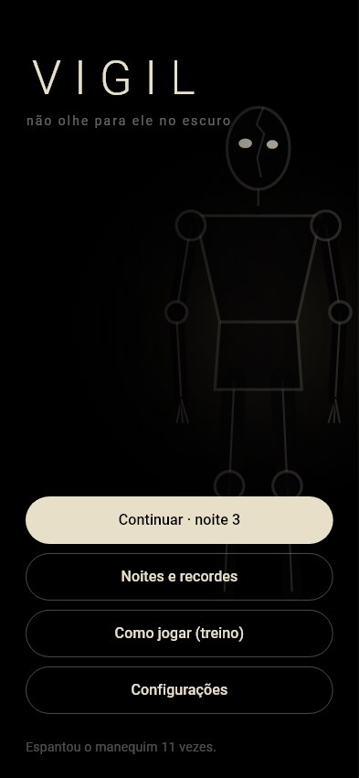
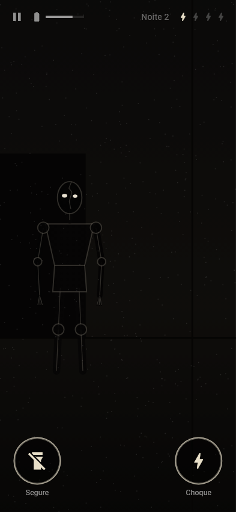
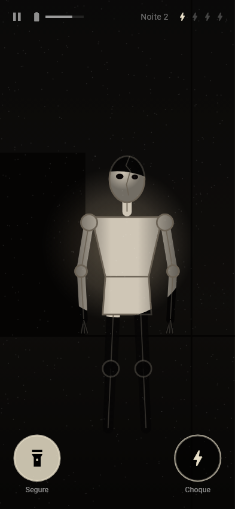
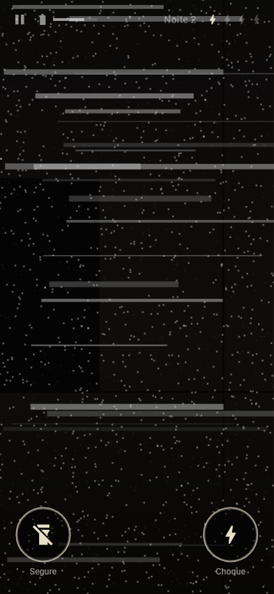
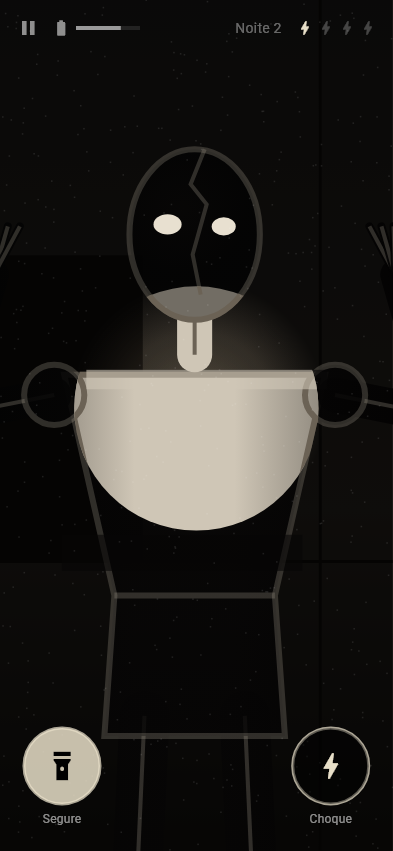
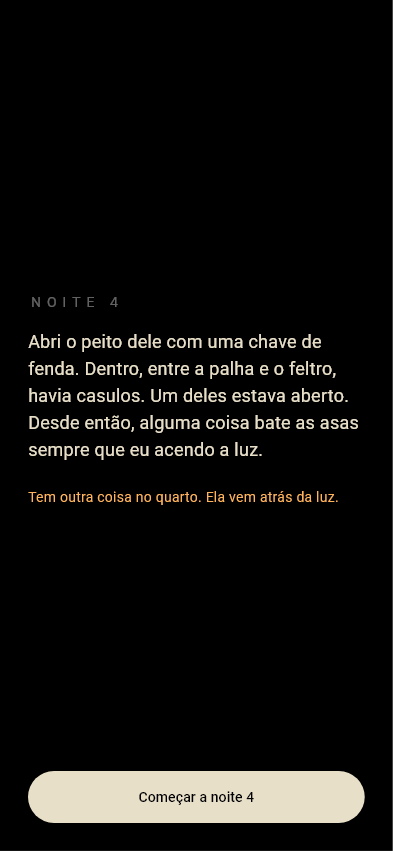
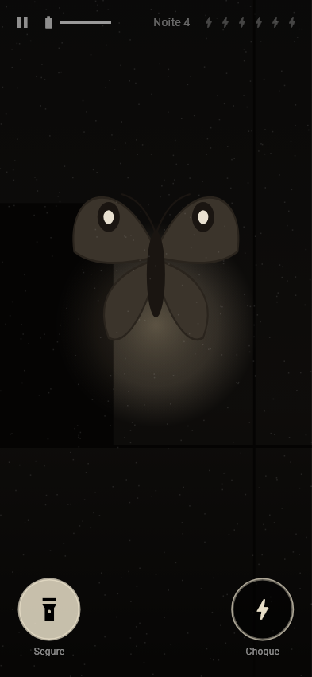

# Vigil

Terror de celular jogado em pé, no seu quarto. A câmera mostra o quarto de verdade, só que escuro, e um **manequim** anda em volta de você. Para achá-lo, você vira o corpo com o celular.

<p>
  
  
  
  
  
</p>

- **Ele anda em volta** e chega cada vez mais perto. Os passos, no fone, dizem de que lado ele está.
- **Às vezes ele some.** Se a tela chiar, ele está ali: segure a lanterna em cima e ele aparece. Mas nem todo chiado é ele.
- **Quando ele corre**, espere chegar perto e dê o **choque**. Cedo demais não pega, e o choque leva um tempo para recarregar.
- **A lanterna gasta a pilha** enquanto você segura e recarrega apagada. A do celular acende junto.
- Espante-o algumas vezes e ele desiste até amanhecer. Cada noite vencida libera a próxima, mais difícil: fintas na 2, corrida invisível na 3 e, na 4, **a Mariposa**, que só avança enquanto a lanterna está acesa.
- **Menu** com treino jogável, noites e recordes, configurações (volume, vibração, câmera, giro, jogar sentado) e um trecho da história antes de cada noite.

<p>
  
  
  
</p>

Versão atual: **0.2.0**, para testar ([o que mudou](CHANGELOG.md)).

## Instalando

Baixe o `Vigil-<versão>.apk` em [Releases](https://github.com/EzioMilanoX/Vigil/releases), abra no celular e permita "instalar apps desconhecidos". O jogo pede a câmera para mostrar o quarto. Dá para jogar sem ela, num quarto desenhado, desligando a câmera nas Configurações.

Precisa de giroscópio, que quase todo celular tem. Com fone fica bem melhor.

## Desenvolvimento

Flutter 3.44 (Android; o Windows serve para testar, arrastando o mouse para girar).

```sh
flutter run                 # no celular conectado
flutter test                # regras da noite e telas
flutter analyze
flutter test telas/telas_test.dart --update-goldens   # regera as capturas acima
flutter test telas/icone_test.dart --update-goldens   # redesenha o ícone
dart run flutter_launcher_icons                       # aplica o ícone
python tools/gerar_sons.py assets/sons                # regera os sons
```

- `lib/game/vigil_game.dart`: as regras de uma noite em Dart puro, determinísticas por semente.
- `lib/ui/`: a tela, o desenho do manequim, os sons com pan e a câmera.
- Os sons são sintetizados por `tools/gerar_sons.py`, sem arquivos de terceiros.

Nasceu do conceito SEN-05 V.I.G.I.L. da minha biblioteca de ideias. Usa mecânicas do gênero de terror em realidade aumentada: a criatura em volta, a invisibilidade revelada pela luz e o choque no tempo certo. A criatura e a arte são originais.

## Licença

[MIT](LICENSE).
